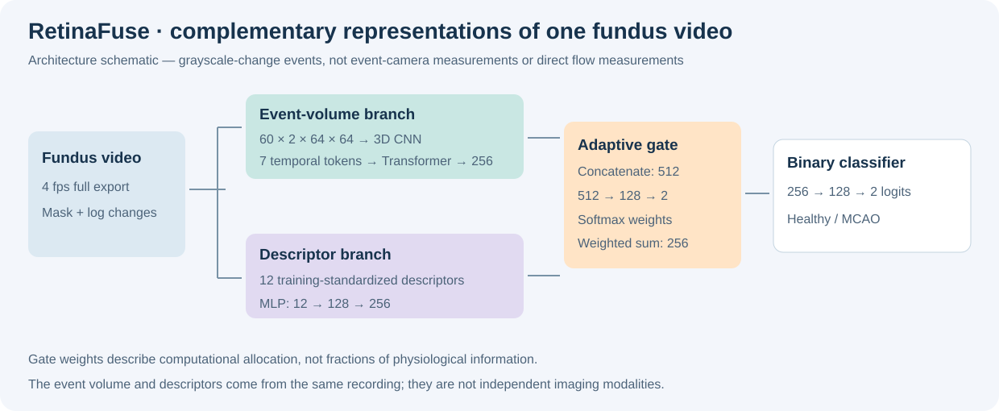
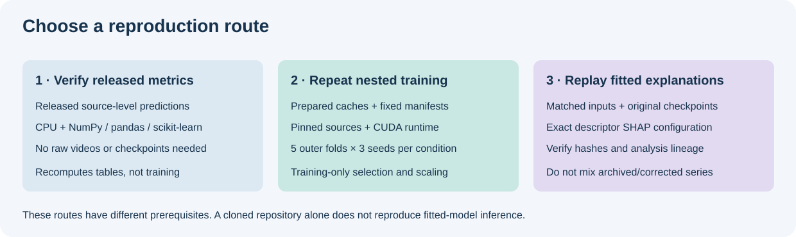

# RetinaFuse

RetinaFuse integrates a learned spatiotemporal event representation and recording-level event statistics for ischaemic stroke phenotyping from contrast-agent-free retinal fundus videos.

The recordings are **fundus videos**. Events encode changes in grayscale intensity computed from video frames.

 



*Architecture schematic verified against the pinned model source*

## Model and scientific comparisons

RetinaFuse encodes a two-polarity, 60-bin event volume with a 3D CNN and a Transformer. A parallel MLP encodes twelve recording-level descriptors. Both embeddings have 256 dimensions. The gate coefficients describe computational allocation.

| Manuscript model | Input and computation | Comparison addressed |
|---|---|---|
| RetinaFuse | Event-volume CNN–Transformer and 12-descriptor MLP with an input-dependent gate | Complementary representations of one video |
| Frame-only | The event-frame CNN–Transformer alone | Contribution of the learned event representation; **not a static-image baseline** |
| Statistics-only | The 12-descriptor MLP alone | Predictive information in recording-level summaries |
| Equal-fusion | Independently trained encoders with weights fixed at 0.5/0.5 | Whether an adaptive rule improves on fixed allocation |
| Global-weight-fusion | Two globally learned softmax weights | Whether weights need to depend on the recording |
| Concat-fusion | Concatenated embeddings projected from 512 to 256 dimensions | Weighted addition versus concatenation; figure label “Concatenation” |
| Single-frame | Midpoint grayscale frame and a 2D CNN | A directly trained static-image control |
| Mean-image | Translation-registered temporal mean and the same 2D CNN architecture | Information retained after temporal averaging |
| Unordered-frames | Shared 2D encoding followed by mean embedding pooling | Multiple frames without ordered sequence aggregation |
| Raw-video | Ordered grayscale frames and a one-channel 3D CNN–Transformer | Direct video representation without event conversion |
| Frame-difference-video | Signed successive-frame differences and the same video encoder | Simple intensity differences versus the event pipeline |
| RF ensemble | ExtraTrees, random forest and logistic-regression combination | A tree-based engineered-feature comparator |
| Set attention | Segment embeddings with attention and maximum pooling | Permutation-invariant segment aggregation |
| SNN | Convolutional spiking stages with surrogate-gradient training | A spiking-network comparator for event representations |

## Repository layout

```text
components/                 # four pinned upstream Git submodules
benchmark/code/             # corrected nested training, decoding and prediction
benchmark/audit_tools/      # contracts and provenance checks
benchmark/followup/         # fixed gate interventions and comparison plans
benchmark/protocol.json     # recorded hyperparameters with portable path fields
data/manifests/             # fixed identifiers, labels, content hashes and folds
results/corrected/          # source-level probabilities, metrics and paired intervals
provenance/                 # source commits, adaptations, hashes and runtime snapshot
scripts/                    # fetch, recompute, prepare-workdir and task entry points
tests/                      # numerical and source-contract checks
docs/                       # methods and analysis/figure mapping
```



## Reproduce the numerical results without training

```bash
git clone --recurse-submodules https://github.com/shumao469/RetinaFuse.git
cd RetinaFuse
python -m venv .venv
# Windows: .venv\Scripts\activate
# Linux/macOS: source .venv/bin/activate
python -m pip install numpy pandas scipy scikit-learn matplotlib
python scripts/recompute_results.py --output recomputed_metrics.csv
python -m unittest discover -s tests -v
```

The script independently recomputes all released seed-ensemble AUROC, AP, Brier and binary metrics from the source-level predictions and checks their agreement with the stored values. 

## Reproduce model training and inference

1. Obtain the original AVI/event dataset through the manuscript Data availability statement. 
2. Inspect `environment-lock.txt` and `provenance/runtime.json`. The recorded environment used Python 3.13.7, PyTorch 2.10.0.dev20251206+cu128, CUDA 12.8 and an RTX 5090. The lock is the actual snapshot. Availability of that historical nightly wheel is not guaranteed; if using another compatible PyTorch/CUDA build, record it as a different runtime.
3. Install the compute dependencies in `requirements-compute.txt`, plus a compatible PyTorch build. Run `python scripts/fetch_sources.py`. This checks out the pinned components and obtains the exact upstream model/mask files by Git blob, verifying their SHA-256 hashes.
4. To reuse prepared inputs, create a **new** working directory with the supplied `data/animal_manifest.csv`, `data/split_manifest.csv`, cached per-source NPZ files and decoder NPZ files. `python scripts/prepare_workdir.py --workdir /path/to/new_run --cached-data /path/to/prepared/data` copies those prepared inputs and writes a portable protocol. 
5. Run one predefined outer task, for example:

```bash
python scripts/run_task.py --workdir /path/to/new_run --model RetinaFuse --condition graychange_4fps_t002 --fold 1 --seed 42
```

Repeat the five outer folds and three fixed seeds for every prespecified model. The task runner uses five inner folds, training-partition standardization, inner-OOF balanced-accuracy threshold selection and a median inner-selected epoch count. It averages final checkpoint logits within each seed. The analysis then averages seed probabilities per source. **Training requires CUDA**; numerical table verification does not.

6. Run `python benchmark/code/analyze.py` with `RETINAFUSE_WORKDIR` pointing to the new run, then the paired-comparison and gate-control entry points documented in `docs/TRAINING_METHODS.md`. Frozen-clean means each checkpoint retains its own clean-input gate for the same source; “equal” replaces the gate by 0.5/0.5 without retraining.

## Exact descriptor SHAP

The full fitted RetinaFuse network can be explained with exact, finite-background Shapley enumeration while retaining the observed event-volume input. The analysis recomputes the descriptor encoder, gate and classifier for each descriptor coalition, rather than explaining a surrogate model. 

See [descriptor SHAP methods and reproduction](docs/DESCRIPTOR_SHAP.md) for input formats, configuration, commands, interpretation boundaries and editable-text SVG/vector-PDF output.

## Detailed architecture and feature definitions

The corrected benchmark wrapper is [benchmark/code/models.py](benchmark/code/models.py). Its event and descriptor encoders are fetched from the exact revision recorded in [frozen vendor sources](provenance/frozen_vendor_sources.json). Use the benchmark wrapper for corrected-series checkpoints; the upstream training entry point is not a drop-in replacement.

| Stage | Implementation |
|---|---|
| Model event input | Batch × 60 time bins × 2 polarities × 64 × 64 |
| 3D convolution | Three 3×3×3 convolutions: 2→32→64→128; batch normalization, GELU and 2× pooling |
| Convolution dropout | 0.15 after the first two pooling stages |
| Token construction | Pooling reduces 60 time bins to 7; each 128×8×8 spatial feature map is projected to 256 |
| Temporal encoder | Sinusoidal positional encoding; one Transformer encoder layer, 8 heads, feed-forward width 512, dropout 0.35 |
| Event embedding | Mean over encoded temporal tokens, linear projection and dropout 0.20; width 256 |
| Descriptor encoder | 12→128, LayerNorm, GELU, dropout 0.15, then 128→256 and LayerNorm |
| Gate | Concatenate both embeddings: 512→128, GELU, dropout 0.20, then 128→2 and softmax |
| Fused representation | Weighted addition of the two 256-dimensional embeddings |
| Classifier | 256→128, GELU, dropout 0.55, then 128→2 logits |

Writing the embeddings as h_event and h_stat:

```text
w = softmax(MLP(concat(h_event, h_stat)))
h_fused = w_event * h_event + w_stat * h_stat
logits = classifier(h_fused)
```

Concatenation is used to compute the gate; **the final RetinaFuse fusion is weighted addition**. Both branches describe the same recording. They are complementary representations rather than independent imaging modalities.

The twelve descriptor inputs, in model order, are:

1. Total event count.
2. Positive event count.
3. Negative event count.
4. Positive event fraction.
5. Mean consecutive event interval.
6. Standard deviation of consecutive intervals.
7. Maximum consecutive interval.
8. Mean horizontal coordinate.
9. Horizontal-coordinate standard deviation.
10. Mean vertical coordinate.
11. Vertical-coordinate standard deviation.
12. Polarity-switch count in stored event order.

Training-partition means and standard deviations are applied to descriptors. Positive/negative events represent increasing/decreasing grayscale intensity, not flow direction. Timestamp intervals depend on video frame timing; many events can share a timestamp. Spatial summaries are not calibrated vessel density, and polarity switches are not cardiac frequency.

## Functional capabilities

| Capability | Relevant implementation / documentation |
|---|---|
| Event reconstruction and decoder controls | [decoder.py](benchmark/code/decoder.py): full-export, sampling-rate, threshold, deduplication, brightness, translation and complement-mask conditions |
| Source identity and cohort preparation | [prepare.py](benchmark/code/prepare.py), [manifests](data/manifests): content hashes, duplicate aliases, grouped nested splits |
| Representation and fusion models | [models.py](benchmark/code/models.py): event, descriptor, static/video and independently trained fusion controls |
| Nested fitting and threshold selection | [train.py](benchmark/code/train.py), [protocol](benchmark/protocol.json) |
| Numerical result verification | [recompute_results.py](scripts/recompute_results.py): recomputation from released predictions |
| Frozen-network gate interventions | [gate_controls.py](benchmark/followup/gate_controls.py): learned, frozen-clean and equal-weight conditions |
| Exact descriptor attribution | [descriptor SHAP guide](docs/DESCRIPTOR_SHAP.md): full-network finite-background enumeration and source-family summaries |
| Integrity and provenance checks | [audit tools](benchmark/audit_tools), [provenance](provenance) |
| Figure traceability | [figure analyses](docs/FIGURE_ANALYSES.md), [source tables](figure_sources) |

There is no packaged web interface, clinical diagnostic service, or generic upload-and-predict command in this repository. A reference fundus image alone is insufficient input for the event-volume model.

## Reproduction checklist and practical operation

### Route 1: inspect and verify the released results

The numerical-reproduction command above needs no CUDA, raw videos or checkpoint binaries. It checks the seed-ensemble predictions against stored metrics. This verifies released table calculations; it does not independently reproduce model training.

Run tests with the same Python interpreter used for dependency installation. Compute-dependent model contracts are skipped when PyTorch or fetched vendor sources are unavailable; skipped tests are not passed architecture tests. See the test runner's individual results.

### Route 2: prepare a fresh training run

The repository ships public manifests under **data/manifests/**. A prepared cache directory has a different layout: the training scripts expect **data/animal_manifest.csv** and **data/split_manifest.csv** inside the new work directory, alongside per-source caches and a decoder subdirectory.

```text
new_run/
  protocol.json
  code/
  audit_tools/
  followup/
  vendor/
  data/
    animal_manifest.csv
    split_manifest.csv
    <animal_id>.npz
    <animal_id>.json
    decoder/
      <animal_id>.npz
      <animal_id>.json
```

 Obtain matching original data/prepared tensors through the study's data-access arrangements. Check identity, source hashes, decoder condition, geometry and split lineage before reuse. Do not assemble caches from unrelated experiments merely because filenames match.

Fetch the pinned upstream source before preparing the work directory:

```bash
python scripts/fetch_sources.py
python scripts/prepare_workdir.py --workdir /path/to/new_run --cached-data /path/to/prepared/data
```

The destination must be empty. Preparation copies the cache and runnable code, potentially using substantial storage. The source cache is retained.

Use one work directory consistently:

```bash
export RETINAFUSE_WORKDIR=/path/to/new_run
```

Windows PowerShell equivalent:

```powershell
$env:RETINAFUSE_WORKDIR = "D:/new_retinafuse_run"
```

Then run the fixed task command shown above. Five outer folds and three seeds mean **15 outer tasks for one model/condition**, each with inner fitting; this is not a quick single training job. Do not choose models or settings from outer-test outcomes.

The recorded runtime is a historical snapshot, not a portable environment installer. In particular, the recorded Python 3.13 runtime and requirements-compute.txt's NumPy 1.26.4 pin are not a guaranteed installable combination. Use an isolated compatible runtime, inspect imported dependencies, and record every substitution. Decoder/source modules additionally import packages such as OpenCV, einops and plotting utilities that are not all listed in the short compute requirements file.

Raw-data preparation via benchmark/code/prepare.py and decoder.py is study-specific. It expects copy/rename lineage, legacy manifests, directory conventions and protocol paths; it is not an automatic converter for arbitrary AVI files. The documented cache route avoids presenting this as a generic raw-video quick start.

### Route 3: re-inference and descriptor SHAP

Exact fitted-model replay requires the original matching checkpoint binaries, training standardization, model revision and input caches. Checkpoint SHA-256 manifests identify weights but do not contain them. There is no claim that the clone alone supplies every fitted model.

Follow [docs/DESCRIPTOR_SHAP.md](docs/DESCRIPTOR_SHAP.md) to create a local configuration, then:

```bash
python benchmark/explain/run_descriptor_shap.py --config benchmark/explain/config.local.json
python benchmark/explain/summarize_descriptor_shap.py --input-dir /path/to/descriptor_shap --lineage /path/to/lineage.csv --output-dir /path/to/shap_tables --supplementary-figure 6
python benchmark/explain/plot_descriptor_shap.py --data /path/to/shap_tables/plot_data.json --output-dir /path/to/shap_plots
```

This analysis evaluates all 4,096 descriptor coalitions using training-only unique-source background donors while retaining the recording's event representation. It recomputes the descriptor encoder, gate and classifier; it is not a surrogate attribution. Use the checkpoint/input series specified by that guide, not the corrected benchmark interchangeably. The resulting attribution explains model computation, not physiological causation.

## Input images, outputs and troubleshooting

The healthy/MCAO images at the top are native-aspect reference fundus frames, not evidence that the model consumes a single static image. The released static/video controls directly resize to 64×64. Display letterboxing does not change training inputs or establish aspect-preserving model results; see [input geometry](docs/INPUT_GEOMETRY.md).

| Artifact | What it provides |
|---|---|
| results/corrected/seed_ensemble_predictions.csv | Source-level probabilities, selected thresholds and decisions |
| results/corrected/seed_ensemble_metrics.csv | Stored metrics checked by the recomputation script |
| results/corrected/paired_comparisons.csv | Released paired comparisons |
| provenance/checkpoint_sha256.csv | Checkpoint identities; not checkpoint binaries |
| figure_sources/ | Numerical panel sources, including explicitly historical series |
| SHAP output directories | Attribution tables and editable-text SVG/vector-PDF panels |

| Symptom | Check |
|---|---|
| Missing benchmark/vendor source | Initialize submodules and run scripts/fetch_sources.py |
| Missing data/animal_manifest.csv | Supply a prepared cache with the expected training-workdir layout |
| CUDA unavailable | Training requires CUDA; metric recomputation does not |
| Historical wheel or NumPy installation fails | Resolve the runtime compatibility and record substitutions |
| Checkpoint load mismatch | Verify model wrapper, source hash, condition, fold, normalization and checkpoint series |
| Results differ from archived figures | Keep archived development, corrected source-disjoint and date-held-out analyses separate |
| Apparently improved figure geometry | A display transform is not retraining or new inference |

The corrected protocol identifies 120 unique source recordings (31 healthy, 89 MCAO) after exact-content deduplication, while retaining 128 identities for audit. These are source-accounting statements from the released protocol; unresolved acquisition metadata must not be inferred from them. No independent external clinical cohort is supplied, and the adverse acquisition-date hold-out result above remains part of the evidence.


## Attribution, scope and rights

The upstream projects retain original rights and are incorporated by pinned gitlinks. See [rights](RIGHTS.md) and [source provenance](provenance/upstream_sources.json). 
