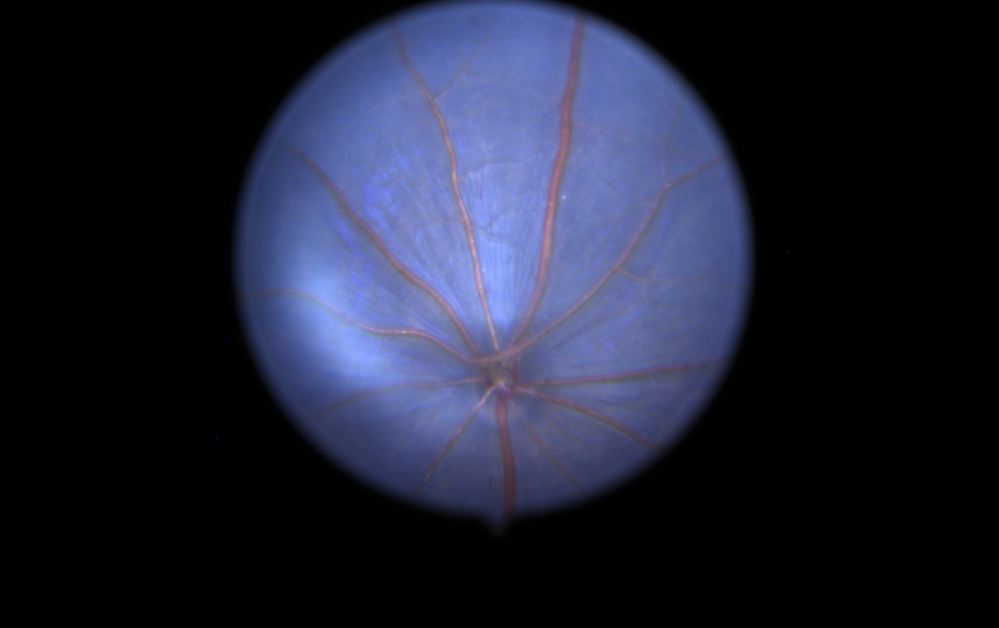
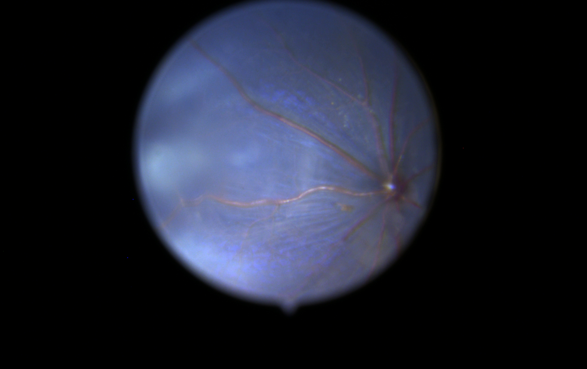

# RetinaFuse

RetinaFuse integrates a learned spatiotemporal event representation and recording-level event statistics for experimental ischaemic stroke phenotyping from conventional, contrast-agent-free retinal fundus videos.

The recordings are **fundus videos**. Events encode changes in grayscale intensity computed from video frames.

 

## Model and scientific comparisons

RetinaFuse encodes a two-polarity, 60-bin event volume with a 3D CNN and a Transformer. A parallel MLP encodes twelve recording-level descriptors. Both embeddings have 256 dimensions. The gate coefficients describe computational allocation, not fractions of physiological information.

| Manuscript model | Input and computation | Comparison addressed |
|---|---|---|
| RetinaFuse | Event-volume CNN–Transformer and 12-descriptor MLP with an input-dependent gate | Complementary representations of one video |
| Frame-only | The event-frame CNN–Transformer alone | Contribution of the learned event representation; **not a static-image baseline** |
| Statistics-only | The 12-descriptor MLP alone | Predictive information in recording-level summaries |
| Equal-fusion | Independently trained encoders with weights fixed at 0.5/0.5 | Whether an adaptive rule improves on fixed allocation |
| Global-weight-fusion | Two globally learned softmax weights | Whether weights need to depend on the recording |
| Concat-fusion | Concatenated embeddings projected from 512 to 256 dimensions | Weighted addition versus concatenation; figure label “Concatenation” |
| Single-frame | Midpoint grayscale frame and a 2D CNN | A directly trained static-image control |
| Mean-image | Translation-registered temporal mean and the same 2D CNN architecture | Information retained after temporal averaging |
| Unordered-frames | Shared 2D encoding followed by mean embedding pooling | Multiple frames without ordered sequence aggregation |
| Raw-video | Ordered grayscale frames and a one-channel 3D CNN–Transformer | Direct video representation without event conversion |
| Frame-difference-video | Signed successive-frame differences and the same video encoder | Simple intensity differences versus the event pipeline |
| RF ensemble | ExtraTrees, random forest and logistic-regression combination | A tree-based engineered-feature comparator |
| Set attention | Segment embeddings with attention and maximum pooling | Permutation-invariant segment aggregation |
| SNN | Convolutional spiking stages with surrogate-gradient training | A spiking-network comparator for event representations |

The RF, Set attention and SNN implementations have different representations and training budgets. Their archived comparison is not a parameter-matched experiment. The three independently trained fusion alternatives are also different experiments from replacing weights in a frozen RetinaFuse network.

## Analyses and released results

The source-disjoint benchmark uses exact-content identification and fixed, source-family-grouped nested folds. Original-only probabilities are averaged over the three prespecified seeds, 42, 1042 and 2042. Cohort accounting is detailed in the manuscript Supplementary Information.

| Corrected, full-export 4-fps pipeline | AUROC | AP | Brier |
|---|---:|---:|---:|
| RetinaFuse | 0.975 | 0.992 | 0.066 |
| Frame-only | 0.953 | 0.984 | 0.079 |
| Single-frame | 0.896 | 0.951 | 0.189 |
| Mean-image | 0.951 | 0.983 | 0.154 |
| Unordered-frames | 0.962 | 0.986 | 0.109 |
| Raw-video | 0.945 | 0.973 | 0.087 |
| Frame-difference-video | 0.906 | 0.957 | 0.134 |

RetinaFuse minus Single-frame AUROC is +0.080 (paired 95% interval +0.022 to +0.149). Its AUROC difference from Mean-image is +0.024 (−0.015 to +0.069). The paired Brier difference from Mean-image is −0.088 (−0.119 to −0.056). These comparisons evaluate entire pipelines, not a causal effect of temporal order.

No universal adaptive-fusion advantage is established: the supplied 99% intervals against Frame-only, Global-weight-fusion and Concat-fusion include zero. At 75% event thinning, learned gating has higher Brier error than frozen-clean weighting. True filename-date-held-out performance is poor (RetinaFuse pooled AUROC 0.361, Brier 0.305). These results are retained rather than selected out.

Archived development figures and three-group rotations are explicitly separate from the source-disjoint experiment. The historical three groups are not verified acquisition dates or external cohorts. Neither analysis is external clinical validation.

## Repository layout

```text
components/                 # four pinned upstream Git submodules
benchmark/code/             # corrected nested training, decoding and prediction
benchmark/audit_tools/      # contracts and provenance checks
benchmark/followup/         # fixed gate interventions and comparison plans
benchmark/protocol.json     # recorded hyperparameters with portable path fields
data/manifests/             # fixed identifiers, labels, content hashes and folds
results/corrected/          # source-level probabilities, metrics and paired intervals
provenance/                 # source commits, adaptations, hashes and runtime snapshot
scripts/                    # fetch, recompute, prepare-workdir and task entry points
tests/                      # numerical and source-contract checks
docs/                       # methods and analysis/figure mapping
```

## Reproduce the numerical results without training

```bash
git clone --recurse-submodules https://github.com/shumao469/RetinaFuse.git
cd RetinaFuse
python -m venv .venv
# Windows: .venv\Scripts\activate
# Linux/macOS: source .venv/bin/activate
python -m pip install numpy pandas scipy scikit-learn
python scripts/recompute_results.py --output recomputed_metrics.csv
python -m unittest discover -s tests -v
```

The script independently recomputes all released seed-ensemble AUROC, AP, Brier and binary metrics from the source-level predictions and checks their agreement with the stored values. It does not smooth curves or fit a model.

## Reproduce model training and inference

1. Obtain the original AVI/event dataset through the manuscript Data availability statement. 
2. Inspect `environment-lock.txt` and `provenance/runtime.json`. The recorded environment used Python 3.13.7, PyTorch 2.10.0.dev20251206+cu128, CUDA 12.8 and an RTX 5090. The lock is the actual snapshot. Availability of that historical nightly wheel is not guaranteed; if using another compatible PyTorch/CUDA build, record it as a different runtime.
3. Install the compute dependencies in `requirements-compute.txt`, plus a compatible PyTorch build. Run `python scripts/fetch_sources.py`. This checks out the pinned components and obtains the exact upstream model/mask files by Git blob, verifying their SHA-256 hashes. It does not relicense the upstream code.
4. To reuse prepared inputs, create a **new** working directory with the supplied `data/animal_manifest.csv`, `data/split_manifest.csv`, cached per-source NPZ files and decoder NPZ files. `python scripts/prepare_workdir.py --workdir /path/to/new_run --cached-data /path/to/prepared/data` copies those prepared inputs and writes a portable protocol. This may copy substantial data; it never edits the original run.
5. Run one predefined outer task, for example:

```bash
python scripts/run_task.py --workdir /path/to/new_run --model RetinaFuse --condition graychange_4fps_t002 --fold 1 --seed 42
```

Repeat the five outer folds and three fixed seeds for every prespecified model. The task runner uses five inner folds, training-partition standardization, inner-OOF balanced-accuracy threshold selection and a median inner-selected epoch count. It averages final checkpoint logits within each seed. The analysis then averages seed probabilities per source. **Training requires CUDA**; numerical table verification does not.

6. Run `python benchmark/code/analyze.py` with `RETINAFUSE_WORKDIR` pointing to the new run, then the paired-comparison and gate-control entry points documented in `docs/TRAINING_METHODS.md`. Frozen-clean means each checkpoint retains its own clean-input gate for the same source; “equal” replaces the gate by 0.5/0.5 without retraining.

## Exact descriptor SHAP

The full fitted RetinaFuse network can be explained with exact, finite-background Shapley enumeration while retaining the observed event-volume input. The analysis recomputes the descriptor encoder, gate and classifier for each descriptor coalition, rather than explaining a surrogate model. 

See [descriptor SHAP methods and reproduction](docs/DESCRIPTOR_SHAP.md) for input formats, configuration, commands, interpretation boundaries and editable-text SVG/vector-PDF output.

## Attribution, scope and rights

The upstream projects retain original rights and are incorporated by pinned gitlinks. See [rights](RIGHTS.md) and [source provenance](provenance/upstream_sources.json). 
